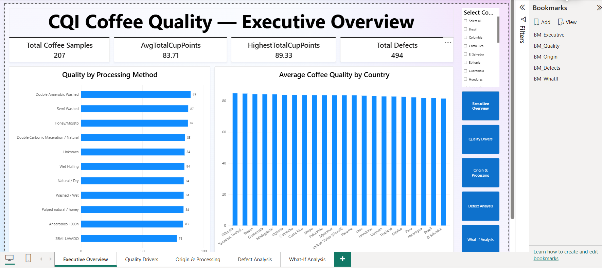
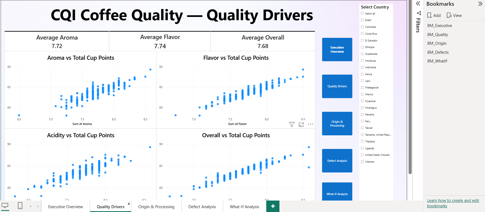
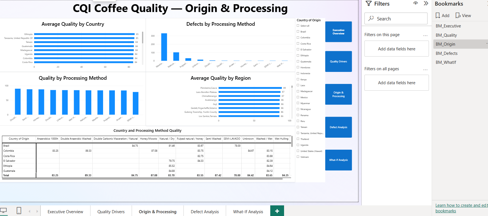
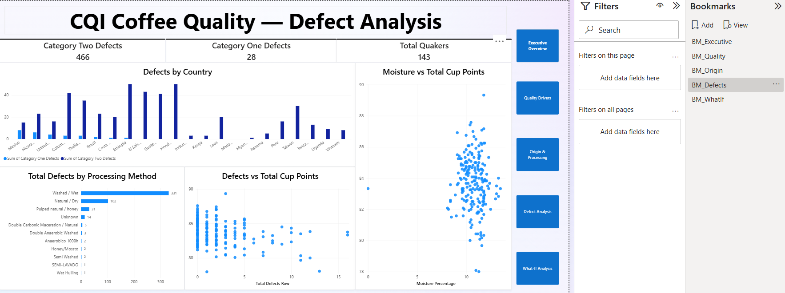

# Coffee Quality Analysis Dashboard

## Project Overview
This project uses Microsoft Power BI to explore coffee quality data and understand patterns in quality scores, defects, coffee origins, and processing methods. The report includes five interactive analytical pages to make the data easier to explore and compare.

## Tools Used
- Microsoft Power BI
- Data visualization
- Interactive report pages and bookmarks

## Dashboard Screenshots

### 1. Executive Overview

### 2. Quality Drivers

### 3. Origin & Processing

### 4. Defect Analysis

### 5. What-If Analysis

## Key Learnings
Through this project, I practiced organizing data into meaningful visuals, comparing coffee quality indicators, exploring defect patterns, and presenting insights through an interactive Power BI report.

## Project File
`CQD_DashBoard.pbix` — Power BI report file containing the five analytical pages.
